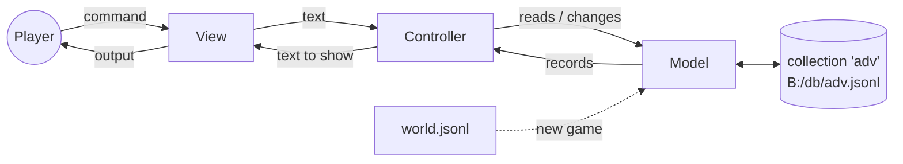

# Text Adventure Framework – Guide

An example framework for writing text adventures in PicoMite BASIC, with a PicoCalc DB collection as the data model, organised as **model–view–controller**. It comes with a short sample game, *The Lighthouse*.

| Page | What it covers |
|---|---|
| [Writing a world](Writing-a-World.md) | The world file: rooms, items, vocabulary, game state, and the rule language for puzzles |
| [How it works](How-It-Works.md) | The three modules, what happens during one command, and how to extend them |

It builds on the PicoCalc DB library; see the [library page of the dbapp developer guide](../dbapp/Library-and-API.md) for the `Db…` API it uses.

## Running the sample game

1. Copy `dist/adventure_app.bas` to the SD card, and `sdcard/adv/world.jsonl` to `B:/adv/world.jsonl`.
2. At the `>` prompt: `DRIVE "B:"` then `RUN "adventure_app.bas"`.

Type commands such as `look`, `n`, `take lamp`, `open desk`, `unlock door with key`, `inventory`, `score`, `help`. The game is saved after every move: quit at any time (`quit`, or even switch off), and the next run offers to continue.

## The design

| Part | File | Prefix | Responsibility |
|---|---|---|---|
| **Model** | `src/adv_model.bas` | `Gm` | The game world and state. The **only** code that uses the database |
| **View** | `src/adv_view.bas` | `Gv` | Printing and reading commands. The **only** code that touches the screen or keyboard |
| **Controller** | `src/adv_ctrl.bas` | `Gc` | Parsing commands, built-in verbs, the rule engine, the game loop |
| Entry | `src/adv_main.bas` | | Sets the folders and calls `GcRun` |

Each part can be changed without the others:

- **New game:** write a new `world.jsonl`. No BASIC changes are needed: puzzles are rules in the data.
- **New look:** change only the view (colours, a status line, the graphics screen).
- **New verbs or rule types:** change only the controller.

The view is *passive*: it never reads the model. The controller fetches what is needed and hands the view plain text, so the view needs no knowledge of records or queries.

## Why a database as the model

- **The world is data.** Rooms, items, words and puzzle rules are records in one JSON Lines file that any text editor can change.
- **Saving is automatic and crash-safe.** Every change (moving, taking, setting a flag) is written to the collection as it happens. The append-only file survives power loss, so there is no save/load code at all.
- **Queries do the searching.** "What is in this room?" is `SELECT * FROM adv WHERE loc = 'r.cottage'`, answered from an index. Rules are found with an indexed query on their verb.
- **The explorer can open it.** Collection `adv` is an ordinary collection: browse or edit a game in progress with the PicoCalc DB explorer, which is handy when writing a world.

## Limits

These come from the library:
- every record is at most 255 characters, so room descriptions are kept to a few sentences;
- every `_id` is at most 16 characters;
- one collection holds at most 1,000 records, which is plenty for a game of this kind.

`s.flags` holds all flags in one record, so a world can have roughly 15 flags with short names.
