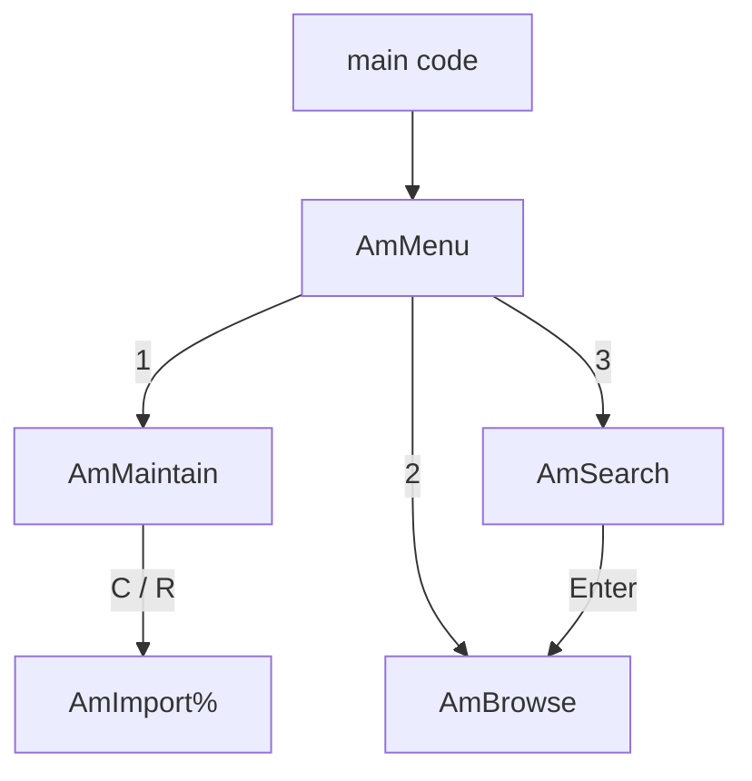

[Home](Home.md) › Program structure

# Program structure

## Assembly

`almanac_app.bas`, the file the user runs, is three parts in one program:

```
dblib (dbcore, dbstore, dbquery, dbexec, dbapi)  →  dbhal.bas  →  almanac.bas
```

The library supplies the database through the `Db…` API, and `dbhal.bas` supplies the screen and keyboard (`HalText`, `HalKey%` …). The almanac code calls only these two interfaces, never the engine's internal routines.

In `almanac_app.bas` all three parts have their comments removed, and the library part has its local variables renamed with `z_`. The dbapp guide explains [how the merged files are put together](../dbapp/Architecture.md#how-the-merged-files-are-put-together).

The main code at the end of `almanac.bas` starts the program. It is at the top level rather than in a SUB, so every call the almanac makes starts one level shallower (the PicoMite's stack is small; see [MMBasic notes](../dbapp/MMBasic-Notes.md#the-call-stack-is-small)):

```basic
' ---- main ----
HalInit
HalCls
DbInit AM_DIR$
AmMenu
DbClose
HalCls
```

## Constants

| Constant | Value | Meaning |
|---|---|---|
| `AM_CSV$` | `B:/almanac.csv` | Data file loaded by Maintain |
| `AM_DIR$` | `B:/db` | Database folder (shared with the explorer) |
| `AM_COL$` | `almanac` | Collection name |
| `AM_FN` | 5 | File number for the CSV; the library uses `#1`–`#3` |
| `AM_MAXL` | 120 | Lines in the day view buffer |
| `AM_MAXHIT` | 300 | Search results kept |
| `AK_…` | | Key codes (as in `dbgui.bas`; Delete is 212 on the PicoCalc) |
| `AS_…` | 0–7 | Display styles, indexes into `dbhal.bas`'s colour table |

## Global state

| Variable | Holds |
|---|---|
| `AmL$()`, `AmLs%()`, `AmLN%` | The day view: wrapped text lines and their styles |
| `AmHit$()`, `AmHitN%` | Search results: the `_id`s of matching records |
| `AmF$()`, `AmFN%` | Fields of the CSV line just parsed |
| `AmFirst%`, `AmLast%` | Day numbers of the first and last day in the collection |
| `AmDrawn%()` | Which screen rows the current frame has drawn |
| `AmPend$`, `AmPendSt%` | A message to show on the next frame |
| `AmMsg$` | Result of the last import |
| `AmOk%`, `AmLong%` | Status flags set by `AmInput$` and `AmReadLine$` |

All names start with `Am` (or `AK_`/`AS_` for constants), clear of the library's prefixes.

## Flow between screens



Each screen is a SUB with its own loop: draw the frame, wait for a key, act on it. Esc leaves the loop and returns to the caller. Moving "back" is simply returning from a SUB, so no screen stack is needed.

One rule keeps this safe: **no screen calls a screen that can lead back to itself.** Search may open Browse, but Browse never opens Search. As explained in [MMBasic notes](../dbapp/MMBasic-Notes.md#loops-and-recursion), re-entering a routine whose `DO` loop is still running would break that loop.

`AmMenu` reopens the collection (`AmOpen%`) every time it draws. That is cheap when the collection is already open (`DbOpen%` returns at once), and it means the menu always shows the current date range after an import.

```basic
FUNCTION AmOpen%()
  LOCAL n%
  AmOpen% = 0
  IF AmHaveCol%() = 0 THEN EXIT FUNCTION
  IF DbOpen%(AM_COL$) = 0 THEN EXIT FUNCTION
  n% = DbCount%()
  IF n% = 0 THEN EXIT FUNCTION
  AmFirst% = AmDays%(LEFT$(AmIdAt$(0), 10))
  AmLast% = AmDays%(LEFT$(AmIdAt$(n% - 1), 10))
  IF AmFirst% < 0 OR AmLast% < 0 THEN EXIT FUNCTION
  AmOpen% = 1
END FUNCTION
```

The date range comes from the first and last records in `_id` order. Their ids start with the date, so no field needs reading.

---
Next: [Data model](Data-Model.md)
