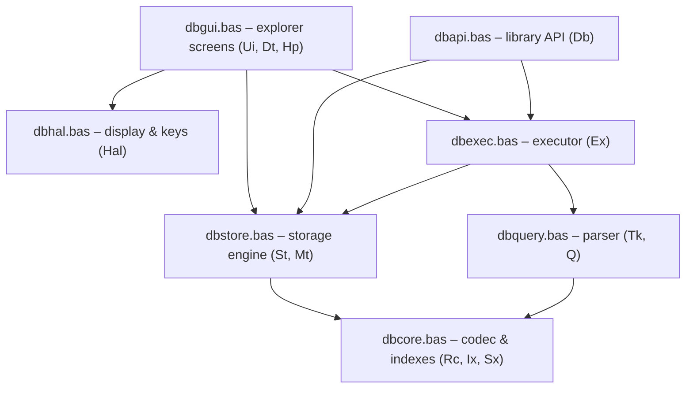

[Home](Home.md) › Architecture

# Architecture

## Layers



Each layer calls only the layers below it:

- **`dbcore.bas`** knows nothing about collections or files beyond "read the line at this offset". It turns record strings into fields and back ([Record codec](Record-Codec.md)), and keeps the in-memory indexes ([Indexes](Indexes.md)).
- **`dbstore.bas`** owns the files: it opens and closes collections, appends records, keeps the index in step, tracks metadata and repairs damage ([Storage engine](Storage-Engine.md)).
- **`dbquery.bas`** turns query text into a *plan*, a set of global arrays describing the statement. It does not touch the data ([Query parser](Query-Parser.md)).
- **`dbexec.bas`** runs a plan against the open collection ([Executor](Executor.md)).
- **`dbgui.bas`** (the explorer) and **`dbapi.bas`** (the library API) are two different front ends on the same engine ([Explorer GUI](Explorer-GUI.md), [Library and API](Library-and-API.md)).

## One program, no modules

MMBasic has no module system: everything is one program with one global name space. The files are simply concatenated in dependency order:

```
dbcore → dbstore → dbquery → dbexec → (dbapi) → (dbhal → dbgui → dbmain)
```

When the program runs, MMBasic executes the top-level statements of every file in that order (the `CONST` and `DIM` lines that create each module's state) and skips over `SUB`/`FUNCTION` bodies. The order matters only for these top-level statements: for example `dbexec.bas` dimensions `ExR%(IX_MAX - 1)`, so `dbcore.bas`, which defines `IX_MAX`, must come first. Calls between routines can go in any direction.

## How the merged files are put together

The module files (`src/` in the repository) are what you edit. What runs on the PicoCalc is a single merged file (`dist/`), because PicoMite loads and runs one program file. Each merged file is a fixed sequence of parts:

| File | Contents, in order | Lines |
|---|---|---|
| `dbapp.bas` | 2 comment lines, `OPTION EXPLICIT`, `OPTION DEFAULT NONE`, then `dbcore`, `dbstore`, `dbquery`, `dbexec`, `dbhal`, `dbgui`, `dbmain`, each unchanged | 2687 |
| `dbapp_min.bas` | The two `OPTION` lines, then the same modules with comments removed | 2218 |
| `dblib.bas` | A comment header, then `dbcore`, `dbstore`, `dbquery`, `dbexec`, `dbapi`, with local variables renamed | 2387 |
| `dblib_min.bas` | One comment line, then the library with comments removed and locals renamed | 1871 |
| `almanac_app.bas` | 2 comment lines, the two `OPTION` lines, the library (comments removed, locals renamed), `dbhal`, `almanac` (comments removed) | 2415 |

### Rules the modules follow so that they can be joined

- **No module contains an `OPTION` statement.** `OPTION EXPLICIT` and `OPTION DEFAULT NONE` must come before any other statement in a program, so the merged application files put them first. They then apply to every module: every variable must be declared, with a type suffix (`%`, `$`, `!`) on every name. The library files contain no `OPTION` lines, so that a program can `#INCLUDE` them after its own.
- **No module contains main-line code**, apart from its `CONST` and `DIM` declarations. The only statements that *do* something are in the last part: `dbmain.bas` sets the database folder, creates it if needed, calls `UiMain` and ends with `END`. `almanac.bas` ends with its call to `AmMain`. Because they come last, every module's declarations have run before the program starts.
- **Only `dbmain.bas` contains `END`.** The library must not contain one at all: when it is kept in flash with `LIBRARY SAVE`, its top-level code runs before every program, and an `END` there would stop the program before it began.
- **Declarations appear in dependency order**, as described in [One program, no modules](#one-program-no-modules). That order is fixed in the list of parts above.

### The comment-free versions

The `_min` files contain the same code with comments, blank lines and indentation removed. A PicoMite stores the program in flash and needs room to run it, and the comments are a large share of the source: `dbapp_min.bas` is about a quarter smaller than `dbapp.bas`. The removal is purely textual: everything from a `'` that is not inside a quoted string to the end of the line, then leading and trailing spaces. The code is otherwise identical, so either version behaves the same.

Every line of a merged file must also fit MMBasic's 255-character program-line limit, which is why long string constants in the modules are built over several lines (for example `QRES$` in `dbquery.bas`).

### Renamed locals in the library

In the library files, and in the library part of `almanac_app.bas`, every SUB and FUNCTION has its local variables and parameters prefixed with `z_` (`rec$` becomes `z_rec$`). Programs using the library are then free to name their own routines `Rec` or `Id$`; see [Library and API](Library-and-API.md#why-the-library-renames-its-local-variables). The explorer files are not renamed: they contain no outside code that could clash.

### Error line numbers

When MMBasic stops with `Error in line 1234`, the number refers to the merged file that is running, not to a module. Open the same merged file to find the line. `dbapp.bas` keeps the modules' comments, so its code is easier to recognise than `dbapp_min.bas`, but the two have different line numbers, so use the one that was running.

## Naming

Because all names are global, every module uses its own prefix for SUBs, FUNCTIONs and global variables:

| Prefix | Module | Prefix | Module |
|---|---|---|---|
| `Rc` | codec (`dbcore`) | `Tk`, `Q` | parser (`dbquery`) |
| `Ix` | primary index (`dbcore`) | `Ex` | executor (`dbexec`) |
| `Sx` | secondary indexes (`dbcore`) | `Db` | library API (`dbapi`) |
| `St` | storage engine (`dbstore`) | `Hal` | display layer (`dbhal`) |
| `Mt` | metadata (`dbstore`) | `Ui`, `Dt`, `Hp` | explorer (`dbgui`) |

Constants use the upper-case form with an underscore: `IX_MAX`, `ST_RD`, `QO_EQ`, `UK_ESC` and so on.

Local variables and parameters are short (`r$`, `i%`, `k$`). MMBasic refuses a program in which a SUB or FUNCTION has the same name as a local variable anywhere, so within the code base no routine may be named like a local (no `SUB Rec`, `FUNCTION Id$`). The library build renames all locals to `z_…` so that programs using the library cannot collide with them; see [Library and API](Library-and-API.md#why-the-library-renames-its-local-variables).

## State lives in global arrays

MMBasic has no records or structures, so every module keeps its state in global variables and **parallel arrays**: element `i` of several arrays together describes one thing. For example the primary index is `IxK$(i)` (the `_id`) plus `IxO%(i)` (its file offset), with `IxN%` entries in use, and a parsed `WHERE` clause is `QnOp%(i)`, `QnF$(i)`, `QnV$(i)`, `QnT%(i)`, `QnTop%(i)` for `QNN%` nodes.

String arrays are always declared with `LENGTH`. Without it every element reserves 256 bytes, which would make the 1,000-entry indexes alone take 256 KB.

## Results and errors

Routines follow one convention throughout:

- Routines that can fail are FUNCTIONs returning `1` (success) or `0` (failure).
- The reason goes in the module's error string: `RcErr$`, `IxErr$`, `StErr$`, `QErr$`, `ExErr$` (and `DbErr$()` in the API). Higher layers copy the lower layer's message upwards rather than inventing a new one, so the user sees the original reason.
- Functions returning text return `""` when they have nothing to return, and set the error string.
- Warnings that are not failures (a repaired file, a rebuilt index) go in `StWarn$`.

Extra results come back through **by-reference parameters** or **status globals**. MMBasic passes variables by reference, so `RcNext%(r$, ip%, k$, v$, t%)` fills in `k$`, `v$` and `t%` in the caller. Status globals are set by the last call: after `RcGet$` you can inspect `RcFound%` (was the field there?) and `RcT%` (its type).

## One open collection

The engine has exactly one *open* collection at a time, named in `StCol$`. Its primary and secondary indexes are the global arrays in `dbcore.bas`. Opening another collection closes the current one (saving its index and metadata). This keeps memory fixed and predictable, at the cost of re-opening when a program alternates between collections.

## File numbers

MMBasic programs refer to open files by number (`#1` to `#10`). The engine uses:

| Number | Constant | Use |
|---|---|---|
| `#1` | `ST_RD` | Reading records; stays open between calls for speed |
| `#2` | `ST_WR` | Appending a record; opened and closed per write |
| `#3` | `ST_TMP` | Index, metadata, and the data file during rebuilds |
| `#4` | `HP_FN` | Explorer only: the help file |

Programs using the library must use `#4` and above (the almanac uses `#5`).

## Configuration and memory

The sizes are constants at the top of the modules:

| Constant | Default | Meaning | Memory |
|---|---|---|---|
| `IX_MAX` | 1000 | Records per collection | `IxK$` + `IxO%`: about 25 KB |
| `IX_KLEN` | 16 | Longest `_id` | |
| `SX_MAX` | 1000 | Secondary index entries, all fields together | `SxV$` + `SxO%`: about 22 KB |
| `SX_SLOTS` | 4 | Indexed fields per collection | |
| `SX_PW` | 11 | Characters of a value kept in a secondary index | |
| `RC_MAXLEN` | 255 | Longest record (the MMBasic string limit) | |
| `MT_MAX` | 24 | Field names tracked in metadata | |
| `QN_MAX` | 24 | Nodes in a `WHERE` clause | |
| `EX_OUTMAX` | 40 | Lines of text output (`DESCRIBE`, `EXPLAIN`, help) | |

On top of the fixed arrays, some operations allocate temporary `LOCAL` arrays: rebuilding the index needs about 16 KB, and `ORDER BY` about 33 bytes per matching row, freed when the routine returns. The executor's result list `ExR%()` is another 8 KB. On an RP2040 Pico this is a large share of the free RAM; if memory runs short, lower `IX_MAX` and `SX_MAX` together.

---
Next: [Data format](Data-Format.md)
